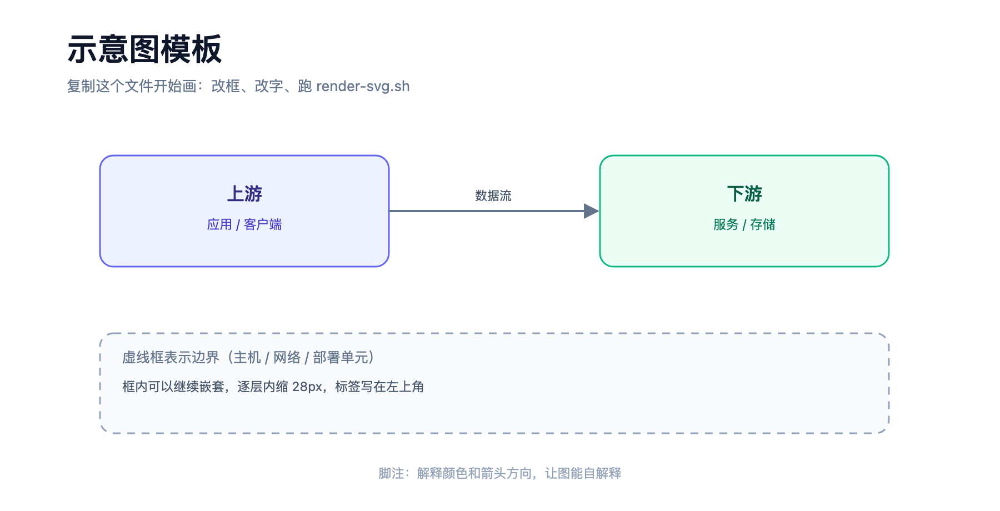

# awesome-skills

一组可复用的 AI Agent 技能（skill）。每个技能都是 `SKILL.md` + 脚本 + 参考文档的结构，可以直接放进 `~/.agents/skills/<name>/` 使用。

## 技能列表

| 技能 | 说明 | 依赖 |
| --- | --- | --- |
| [`svg-diagram`](skills/svg-diagram/) | 手写 SVG 画架构图 / 数据流图 / 部署拓扑图，用 headless Chrome 渲染成 2 倍 PNG | Chrome 或 Chromium、python3 |

## 安装

```bash
# 方式一：复制
cp -r skills/svg-diagram ~/.agents/skills/

# 方式二：软链接（改完立即生效，适合本地迭代）
ln -sfn "$PWD/skills/svg-diagram" ~/.agents/skills/svg-diagram
```

## svg-diagram

不用 Mermaid / Graphviz 的自动布局，直接手写 SVG 标签，换来对版式的完全控制：分层、汇聚分叉、框内多行中文、箭头走向都可以精确摆位，改一个颜色只是改一行属性。



### 用法

```bash
# 从模板开始
cp skills/svg-diagram/assets/template.svg docs/my-diagram.svg

# 改完渲染（输出同名 .png，2 倍图）
skills/svg-diagram/scripts/render-svg.sh docs/my-diagram.svg
```

### 目录

```
skills/svg-diagram/
├── SKILL.md                     # 流程、画布约定、配色表、质量检查清单
├── agents/openai.yaml           # 显示名 / 简介
├── scripts/render-svg.sh        # SVG → PNG，处理了 Chrome 不退出等坑
├── references/svg-patterns.md   # 箭头、总线、嵌套框、竖排标签等可复制片段
└── assets/template.svg          # 起手模板
```

### 为什么手写 SVG

- Mermaid / Graphviz 是自动布局，位置由算法决定，做不了"三层汇聚 + 一行三列 + 底部回流"这种精确版式
- SVG 是纯文本：可 diff、可脚本生成、可无损缩放
- 渲染只依赖 Chrome，不需要 rsvg / inkscape / cairo

## 许可

仓库暂未指定开源许可。若要允许他人自由使用，建议补充 `LICENSE`（如 MIT）。
